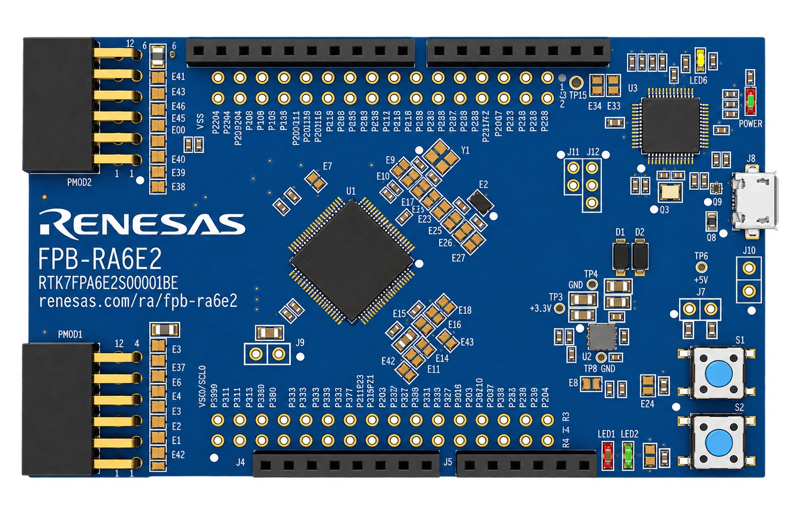
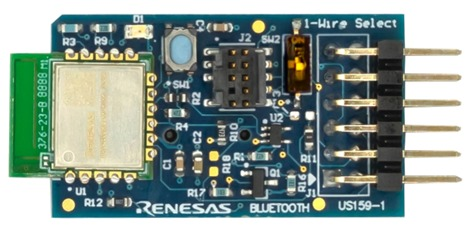
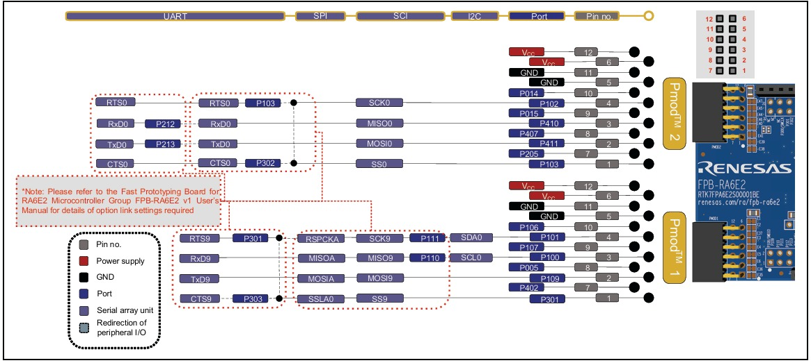
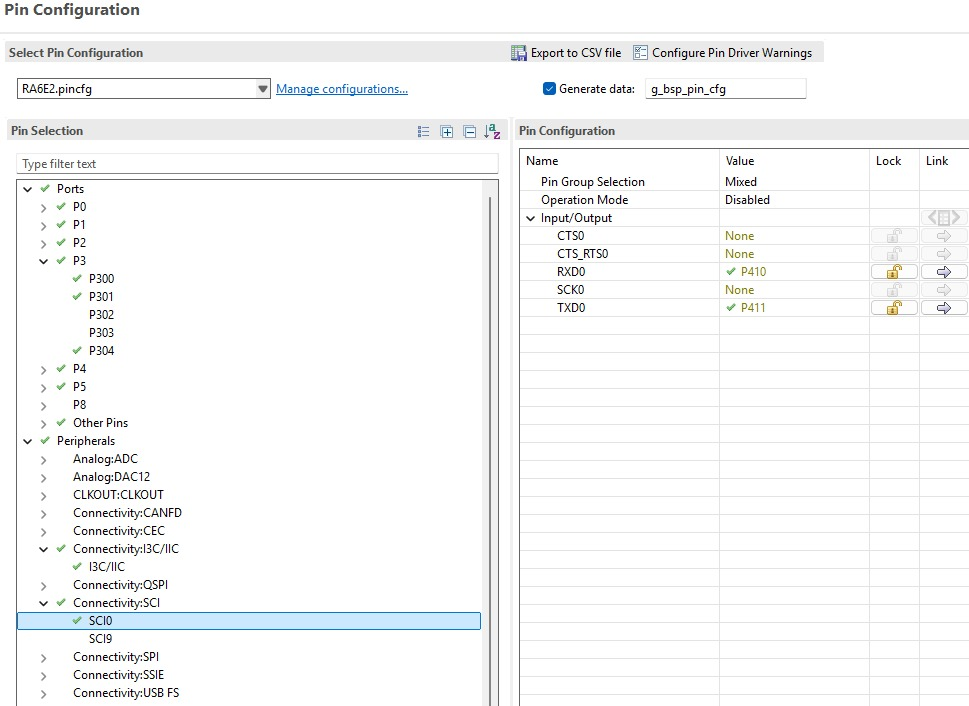
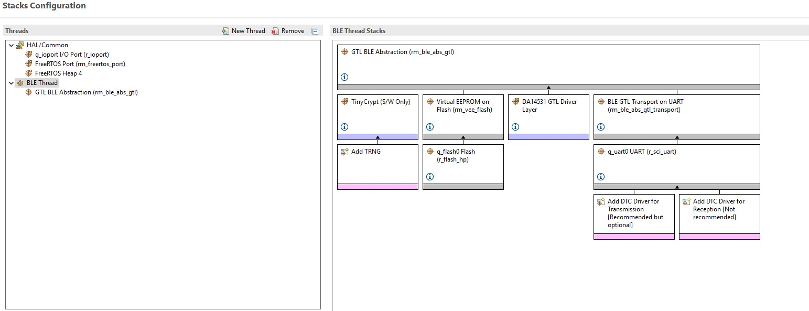
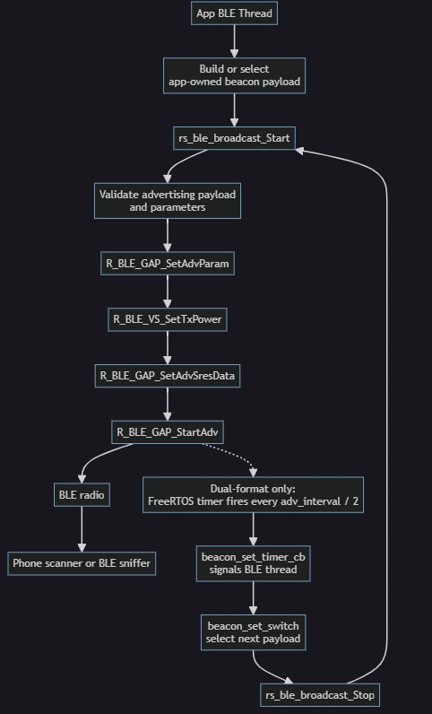
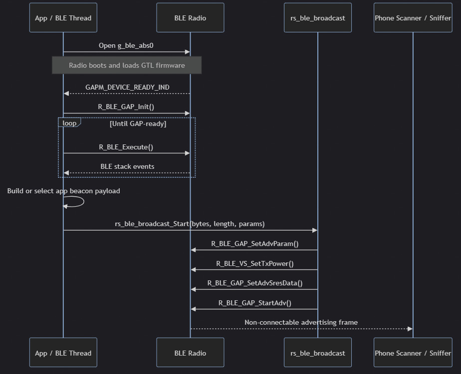

# BLE Beacon Broadcasting
## FPB-RA6E2 + DA14531 BLE + iBeacon / Eddystone-URL

| | |
|---|---|
| **MCU** | R7FA6E2BB3CFM — Cortex-M33 · 200 MHz · RA6E2 |
| **BLE Radio** | DA14531 (US159-DA14531EVZ) — Bluetooth 5.1, GTL over UART |
| **Beacon Formats** | iBeacon and/or Eddystone-URL — legacy non-connectable advertising |
| **FSP** | v6.5.0 + FreeRTOS · direct FSP GAP advertising APIs |

> `ble_beacon_broadcasting_example_ra6e2` · FSP v6.5.0 · RA6E2 · Rev 1.0 · August 2026

---

## About This Repository

This project is the reference firmware inside the standalone `ble-beacon-broadcast`
repo, which also ships the reusable BLE Beacon Broadcasting RS as a
library at the repo root:

```
ble-beacon-broadcast/
├── src/                    ← The RS: rs_ble_broadcast.{h,c} (source of truth)
└── examples/
    └── ra6e2/fpb-ra6e2/     ← This project
```

[`rs_ble_broadcast.h`](src/rs_ble_broadcast.h) is the single public
header of a self-contained advertising module that issues direct FSP GAP
calls (`R_BLE_GAP_*`, `R_BLE_VS_*`) — no HAL, no operation table, no
chip-selection abstraction. Design highlights:

* **Two public APIs** — `rs_ble_broadcast_Start()` and `rs_ble_broadcast_Stop()`
* **Fully payload-agnostic** — no beacon format types, no `*_INIT` macros, no
  format switch, no timer; the caller (this example's app code) owns all of that
* **FSP-native return type** — `ble_status_t`, unchanged from the underlying
  `R_BLE_GAP_*` / `R_BLE_VS_*` call, except for a RS-added argument check on
  `Start()`
* **BLE-stack init is out of scope** — the caller must already have the BLE
  stack GAP-ready (DA14531 GTL firmware, UART, `rm_ble_abs_gtl` open) before
  calling `Start()`

This example vendors its own committed copy of the library at
[`src/rs_ble_broadcast/`](examples/ra6e2/fpb-ra6e2/src/rs_ble_broadcast/) so that a plain checkout
builds standalone in both e² studio and VS Code with no cross-repo reference
— see [7.1](#71-project-structure) for details. The repo root `src/` remains
the source of truth; the example's copy is refreshed by hand when it changes.

---

## Table of Contents

1. [Overview](#1-overview)  
2. [Key Features](#2-key-features)  
3. [Dependencies](#3-dependencies)  
   - 3.1 [FPB-RA6E2 Fast Prototyping Board](#31-fpb-ra6e2-fast-prototyping-board)  
   - 3.2 [US159-DA14531EVZ BLE Module](#32-us159-da14531evz-ble-module)  
   - 3.3 [Beacon Formats](#33-beacon-formats)  
   - 3.4 [Pin Connections](#34-pin-connections)  
   - 3.5 [Software Requirements](#35-software-requirements)  
   - 3.6 [Toolchain Environment Variables](#36-toolchain-environment-variables)  
4. [FSP Configuration](#4-fsp-configuration)  
   - 4.1 [BSP Settings](#41-bsp-settings)  
   - 4.2 [FSP Stack Overview](#42-fsp-stack-overview)  
5. [Demo Bring-Up](#5-demo-bring-up)  
6. [Usage](#6-usage)  
7. [Data Flow Architecture](#7-data-flow-architecture)  
   - 7.1 [Project Structure](#71-project-structure)  
   - 7.2 [Software-Layer Architecture](#72-software-layer-architecture)  
   - 7.3 [RTOS Task Map](#73-rtos-task-map)  
   - 7.4 [Beacon Advertising Profile](#74-beacon-advertising-profile)  
   - 7.5 [Key Functions](#75-key-functions)  
8. [Runtime Flow](#8-runtime-flow)  
   - 8.1 [Boot / GAP-Ready / Broadcast Sequence](#81-boot--gap-ready--broadcast-sequence)  
9. [Configuration Parameters](#9-configuration-parameters)  
10. [Error Handling](#10-error-handling)  
11. [Known Limitations & Open Issues](#11-known-limitations--open-issues)  
12. [Integration Notes](#12-integration-notes)  
13. [Troubleshooting](#13-troubleshooting)  
14. [Summary](#14-summary)  
15. [References & Documentation](#15-references--documentation)  

---

## 1. Overview

This project broadcasts standards-compliant BLE beacon frames using a Renesas RA6E2 MCU (R7FA6E2BB3CFM, Arm® Cortex®-M33) and an external DA14531 BLE radio on the US159-DA14531EVZ module. There is no on-chip BLE on the RA6E2; BLE stack processing runs on the DA14531 and is reached through UART using Renesas GTL, the Generic Transport Layer protocol. At startup the RA boots the DA14531 itself, loading its GTL firmware over UART.

The application supports iBeacon, Eddystone-URL, or both formats. Beacon payload structures and payload bytes are created by the app. The reusable `rs_ble_broadcast` RS core receives only a pointer to opaque advertising bytes, their length, and advertising parameters; it configures and starts non-connectable legacy advertising through direct FSP GAP APIs.

The application is built on Renesas FSP v6.5.0 with FreeRTOS. The BLE thread owns UART/GTL traffic, BLE stack processing, and every call to `rs_ble_broadcast_Start()` and `rs_ble_broadcast_Stop()`.

In a single-format build, the selected beacon advertises continuously. In a dual-format build, a FreeRTOS software timer signals the BLE thread every half advertising interval. The BLE thread stops the active advertising set and restarts it with the other resident payload. No fixed polling loop, GATT profile, pairing flow, or phone connection is used.

> **Note:** GATT (Generic Attribute Profile) is how a connected BLE device exposes its data as services and characteristics. A CCCD (Client Characteristic Configuration Descriptor) is the descriptor a client writes to subscribe to a characteristic's notifications. A beacon only broadcasts, so it needs neither.

---

## 2. Key Features

- **Non-connectable BLE broadcasting** — uses `ADV_NONCONN_IND`; scanners can observe frames without pairing or connecting.
- **iBeacon and Eddystone-URL support** — select either format or both at compile time.
- **Payload-agnostic RS core** — beacon structs and byte construction remain in the app.
- **Direct FSP GAP control** — no HAL, operation table, or chip-selection abstraction.
- **Dual-format alternation** — optional timer-driven iBeacon ⇄ Eddystone-URL switching at `adv_interval / 2`.
- **BLE-thread-only control** — FSP BLE and RS APIs are called only from the BLE FreeRTOS thread.
- **No GATT dependency** — the application does not require BLE profiles, CCCD, connection-state handling, or a smartphone connection.

| Format | Advertising type | Typical payload content | Client behavior |
|---|---|---|---|
| iBeacon | Legacy non-connectable | UUID, major, minor, measured power | Scanner identifies beacon and displays proximity data |
| Eddystone-URL | Legacy non-connectable | URL scheme, encoded URL, Tx power | Scanner resolves and displays URL |
| Dual format | Alternating legacy non-connectable | Both payloads at separate addresses | Scanner observes frames alternately |

---

## 3. Dependencies

### 3.1 FPB-RA6E2 Fast Prototyping Board



*Figure 1 — FPB-RA6E2*

| Resource | Detail |
|---|---|
| MCU | R7FA6E2BB3CFM — Arm Cortex-M33, up to 200 MHz |
| Flash / RAM | 512 KB Flash / 128 KB RAM |
| Package | 64-pin LQFP |
| PMOD connectors | Use PMOD2 for DA14531 |
| Debug interface | On-board J-Link (RA4M2 debug MCU, SWD) |
| BSP heap | Minimum 2 KB required for GTL operation |

### 3.2 US159-DA14531EVZ BLE Module



*Figure 2 — US159-DA14531EVZ*

| Feature | Detail |
|---|---|
| BLE IC | DA14531 — ultra-low-power Bluetooth 5.1 SoC |
| Host link | UART using Renesas GTL protocol |
| UART channel | SCI0 |
| Firmware | DA14531 GTL firmware v6.0.23.1468, bundled with FSP (`r_ble_gtl_image.c`); no pre-programming needed |
| Boot mode | Boot from host over 1-wire UART — on every `RM_BLE_ABS_Open()` the RA resets the DA14531 (P407) and loads the GTL firmware into its RAM; the DA14531 flash is not used |
| BLE role | GAP Broadcaster |
| Advertising mode | Non-connectable, undirected legacy advertising |
| Advertising handle | Fixed handle `0` |
| Advertising channels | 37, 38, and 39 |

### 3.3 Beacon Formats

The application constructs beacon advertising payloads using app-owned packed wire-layout structures.

| Format | App file | Key fields | Maximum advertising length |
|---|---|---|---:|
| iBeacon | `beacon_ibeacon.h` | Apple company ID, UUID, major, minor, measured power | 30 bytes |
| Eddystone-URL | `beacon_eddystone.h` | Eddystone UUID, URL scheme, encoded URL, Tx power | 31 bytes |
| Future custom format | New app header | Application-defined | 31 bytes |

The `rs_ble_broadcast` RS does not include these headers or inspect the payload bytes.

**Recognizable default identities** (set in `beacon_ibeacon.h` / `beacon_eddystone.h`):

- **iBeacon:** major = `0xDA14`, minor = `0x0531` → reads as "DA14 0531" = DA14531; UUID = ASCII `RENESAS DA14531!` → `52454E45-5341-5320-4441-313435333121`; Apple Manufacturer-Specific Data uses company `0x004C`, type `0x02`, len `0x15`; default measured power (RSSI @ 1 m) is −59 dBm.
- **Eddystone-URL:** `http://www.renesas.com` (scheme `HTTP_WWW` + URL `renesas.com`); Service Data for UUID `0xFEAA`, frame type `0x10`; encoded URL limited to ≤ 17 bytes; default Tx power (@ 0 m) is −22 dBm.
- Both: ~1 s advertising interval, non-connectable, channels 37/38/39. Both frames stay ≤ 31 bytes (legacy advertising) — the builder fails rather than truncate.

Override the defaults with the `IBEACON_CFG_*` `#define`s (before `#include "beacon_ibeacon.h"`) or the `EDDYSTONE_CFG_*` `#define`s (before `#include "beacon_eddystone.h"`).

### 3.4 Pin Connections



*Figure 3 — FPB-RA6E2 Pmod Interface*



*Figure 4 — RASC Pin Configuration: SCI0 UART (RXD0 = P410, TXD0 = P411)*

| Signal | FPB-RA6E2 Pin | Function |
|---|---|---|
| DA14531 TX (GTL) | RXD0 (SCI0) — P410 / `PMOD2_MISO_ARDUINO_D0` | UART receive from DA14531 |
| DA14531 RX (GTL) | TXD0 (SCI0) — P411 / `PMOD2_MOSI_ARDUINO_D1` | UART transmit to DA14531 |
| DA14531 RESET | P407 | DA14531 hardware reset line |
| DA14531 CTS assertion | P102 | Static GPIO output driven low |
| DA14531 power | 3.3 V and GND | PMOD power supply |

> **Important:** The DA14531 CTS line must be asserted by configuring P102 as a static GPIO output driven low before the BLE stack is initialized.

### 3.5 Software Requirements

| Software | Version / Notes |
|---|---|
| Renesas FSP | v6.5.0 |
| RTOS | FreeRTOS |
| SEGGER J-Link Software Pack | Optional — J-Link RTT Viewer, to read `MSG_PRINT` debug output |
| Renesas SmartBond smartphone application | To scan for the beacon |

### 3.6 Toolchain Environment Variables

The VS Code / CMake build (`CMakeLists.txt`, `Config.cmake`, `cmake/llvm.cmake`) targets the LLVM Arm Toolchain for Embedded (ATfE) and reads the following environment variables so the project builds without editing any tracked file, on any machine or workspace:

| Variable | Tool | Used for | Required? |
|---|---|---|---|
| `ARM_TOOLCHAIN_PATH` | ATfE `bin` folder (contains `clang`, `ld.lld`, `llvm-*`) | Compiling and linking | Yes |
| `NINJA_PATH` | Ninja `bin` folder | Building via the Ninja generator | Yes, if using the Ninja kit |
| `RASC_EXE_PATH` | Renesas Smart Configurator executable | Regenerating FSP content during the build | Optional — auto-detected under the common per-OS RASC install roots if not set |

Set these once per machine (shell profile, or system environment variables on Windows), then select the ARM LLVM (ATfE) - Ninja kit in VS Code's CMake extension. e² studio does not use these variables — it resolves the LLVM toolchain through its own Renesas Toolchain Management registration instead.

---

## 4. FSP Configuration

FSP configuration is performed through e² studio or Renesas Smart Configurator.

### 4.1 BSP Settings

| Setting | Value |
|---|---|
| FSP version | 6.5.0 |
| Board | FPB-RA6E2 |
| Device | R7FA6E2BB3CFM |
| RTOS | FreeRTOS |
| BSP heap | 2 KB (`0x800`), the minimum required for GTL |

### 4.2 FSP Stack Overview



*Figure 5 — RASC Stacks Configuration: BLE Thread (`rm_ble_abs_gtl` → TinyCrypt / Virtual EEPROM / DA14531 GTL driver / BLE GTL Transport on UART → `g_uart0` + DTC)*

| FSP Module | Instance | Role |
|---|---|---|
| `g_ble_abs0` (`RM_BLE_ABS`, GTL) | — | BLE abstraction and GTL transport to the DA14531 through SCI0 |
| `r_sci_uart` | SCI0 | UART transport for GTL communication |
| `r_ioport` | — | DA14531 reset and static CTS GPIO control |
| FreeRTOS | — | Runs BLE thread and optional dual-format timer |
| `R_BLE_GAP_*` | — | Configures, starts, and stops legacy non-connectable advertising |
| `R_BLE_VS_SetTxPower()` | — | Configures DA14531 vendor-specific Tx power level |

---

## 5. Demo Bring-Up

### Step 1: Hardware Setup

1. Seat the US159-DA14531EVZ module on the designated FPB-RA6E2 PMOD2 connector.
2. No DA14531 firmware needs to be programmed. On every `RM_BLE_ABS_Open()` the RA resets the DA14531 and loads the GTL firmware (v6.0.23.1468, bundled with FSP in `r_ble_gtl_image.c`) into its RAM over UART. The DA14531 flash is not reprogrammed.

### Step 2: Add Project to IDE

Use section A for e² studio and section B for VS Code.

### Step 2.A: Import the Project into e² studio

1. Launch e² studio and select a workspace path with no spaces.
2. Select File → Import → General → Existing Projects into Workspace → Next.
3. Browse to the `fpb-ra6e2` project folder (`examples/ra6e2/fpb-ra6e2`); e² studio will detect it as `ble_beacon_broadcasting_example_ra6e2`.
4. Finish the import.

### Step 2.B: Open Project in VS Code

1. Launch VS Code and select File → Open Workspace from File....
2. Navigate to and select `fpb_ra6e2.code-workspace` (`examples/ra6e2/fpb-ra6e2/fpb_ra6e2.code-workspace`).
3. Click Open. The workspace opens with the `ble_beacon_broadcasting_example_ra6e2` board project, including its local `src/app` (app sources) and `src/rs_ble_broadcast` (the committed RS core copy).
4. Select the configured ARM LLVM / Ninja build environment when prompted.
5. Use the default Debug build configuration.

### Step 3: Review FSP Configuration

Open `configuration.xml` in the RA Configuration view and confirm:

- BSP device is `R7FA6E2BB3CFM`;
- FSP version is 6.5.0;
- FreeRTOS is enabled;
- SCI0 UART and GTL transport are configured;
- `g_ble_abs0` is present;
- P407 is configured for DA14531 reset;
- P102 is configured as a GPIO output driven low;
- BSP heap is at least 2 KB.

### Step 4: Build

Use section A for e² studio and section B for VS Code.

### Step 4.A: Build in e² studio

1. Confirm that the active build configuration is Debug.
2. Press Ctrl+B or right-click the project and select Build Project.
3. Confirm the build completes with zero errors.

Output files are written to the project's `Debug/` directory, including:

```text
ble_beacon_broadcasting_example_ra6e2.elf
ble_beacon_broadcasting_example_ra6e2.srec
ble_beacon_broadcasting_example_ra6e2.map
```

### Step 4.B: Build in VS Code

1. Select the build icon in the bottom bar or the Build option in the CMake extension.
2. Confirm that the build finishes with exit code `0`.

Output files are written to:

```text
build/Debug/
```

### Step 5: Flash and Run

Use section A for e² studio and section B for VS Code.

### Step 5.A: Flash and Run in e² studio

1. Start a Renesas GDB Hardware Debugging session.
2. Download the application to the FPB-RA6E2.
3. Resume execution.
4. The BLE thread initializes SCI0, GTL, DA14531 controls, `g_ble_abs0`, and the DA14531 BLE stack.
5. After the DA14531 reaches GAP-ready state, the app starts the selected beacon payload.

Boot call flow:

```text
main()                                  ← FSP generated
└─ ble_thread_entry()                   ← FreeRTOS BLE task
   ├─ Configure DA reset / CTS control
   ├─ Open g_ble_abs0
   ├─ R_BLE_GAP_Init()
   ├─ R_BLE_Execute() until GAP-ready
   └─ beacon_set_init()
      └─ rs_ble_broadcast_Start()
```

### Step 5.B: Flash and Run in VS Code

1. Confirm the micro-USB cable is connected to the J-Link USB port and the board is powered.
2. Press Ctrl+Shift+D to open Run and Debug.
3. Verify the `launch.json` configuration:
   - ELF executable path;
   - J-Link GDB server address and port;
   - GDB path;
   - target device;
   - extended remote target address.
4. Select Start Debugging.
5. Resume execution after the debugger stops at `main()`.

### Step 6: Read the RTT Debug Output

1. Optional: viewing the RTT output is not required for normal operation. To view it, open J-Link RTT Viewer on the PC the board is connected to (from the SEGGER J-Link Software Pack):
   - Connection to J-Link: USB
   - Target device: R7FA6E2BB
   - Target interface & speed: SWD, 4000 kHz
   - RTT control block: Auto Detection (or the `_SEGGER_RTT` address from the build's `.map` file — `Debug/ble_beacon_broadcasting_example_ra6e2.map` in e² studio, `build/Debug/ble_beacon_broadcasting_example_ra6e2.map` in VS Code)

   The output appears on Terminal 0. A healthy start prints:

   ```text
   INF: ble_app_run: BLE stack up, advertising started
   ```

   This line confirms the BLE stack came up and the first beacon started advertising. Any `ERR: …` line reports a failure (see [10](#10-error-handling)).
2. Scan for the beacon as described in [6](#6-usage).

> **Note:** For customer hardware or another RA MCU, see [Section 12](#12-integration-notes). The above steps apply to the packaged FPB-RA6E2 reference configuration.

---

## 6. Usage

1. Build, flash and run the application (see [5](#5-demo-bring-up)).
2. Open the Renesas SmartBond app on a phone ([Android](https://play.google.com/store/apps/details?id=com.renesas.smartbond) / [iOS](https://apps.apple.com/us/app/renesas-smartbond/id1623197578)).
3. Scan nearby legacy advertising devices.
4. Verify the selected beacon format:
   - For iBeacon, verify UUID, major, minor, and measured-power data.
   - For Eddystone-URL, verify the advertised URL.
5. If both formats are enabled, observe that the scanner detects iBeacon and Eddystone-URL frames alternately.
6. Optional: check the RTT debug output for the `INF: ble_app_run: BLE stack up, advertising started` line (see [5](#5-demo-bring-up), Step 6).

No BLE pairing, connection, GATT discovery, or notification subscription is required.

> **Note:** iOS hides iBeacon payloads from SmartBond and other generic BLE scanner apps. To verify iBeacon frames, use SmartBond on an Android phone.

---

## 7. Data Flow Architecture

### 7.1 Project Structure

```text
fpb-ra6e2/                             ← This project (examples/ra6e2/fpb-ra6e2)
│
├── src/
│   ├── ble_thread_entry.c             ← FSP-owned thread shim → calls ble_app_run()
│   │
│   ├── SEGGER_RTT/                    ← SEGGER RTT 7.50a (SEGGER sources, wrapped in `#ifdef RTT_DEBUG_ON`) — debug output over J-Link
│   │
│   ├── app/                           ← Board-agnostic app sources (committed locally)
│   │   ├── ble_app.c / .h             ← BLE init, GAP-ready wait, event-driven service loop
│   │   ├── ble_app_glue.c             ← Regeneration-safe glue for FSP-generated hooks
│   │   ├── msg_print.h                ← MSG_PRINT debug-print hook (SEGGER RTT by default)
│   │   ├── beacon_config.h            ← Compile-time format selection (iBeacon/Eddystone)
│   │   ├── beacon_set.c / .h          ← Payload slots + dual-format alternation
│   │   ├── beacon_ibeacon.h           ← iBeacon payload struct + defaults
│   │   ├── beacon_eddystone.h         ← Eddystone-URL payload struct + defaults
│   │   ├── hal_warmstart.c            ← DA14531 reset / CTS pin control
│   │   └── ble/
│   │       └── qe_ble_profile.c / .h  ← Baseline GAP/GATT attribute table required by the vendor GTL driver
│   │
│   └── rs_ble_broadcast/             ← Committed copy of the repo-root RS core (../../../src)
│       ├── rs_ble_broadcast.h         ← Public API: Start() / Stop()
│       └── rs_ble_broadcast.c
│
├── ra/ , ra_gen/ , ra_cfg/            ← FSP + CMSIS + FreeRTOS + generated config (do not edit)
│
├── script/
│   └── fsp.lld                        ← LLVM/lld linker script (RASC-generated)
│
├── cmake/                             ← ATfE toolchain file + RASC-generated flags/sources (llvm.cmake, prebuild.cmake,
│                                        GeneratedCfg.cmake, GeneratedSrc.cmake)
├── .vscode/                           ← CMake kits, IntelliSense, tasks, launch config (cmake-kits.json, c_cpp_properties.json,
│                                        settings.json, tasks.json, launch.json)
│
├── CMakeLists.txt                     ← Adds app/RS sources (src/app, src/rs_ble_broadcast) to the RASC-generated build
├── Config.cmake                       ← RASC_EXE_PATH auto-detection / override
├── configuration.xml                  ← FSP stacks + pins (open in e² studio / RASC)
├── RA6E2.pincfg
├── .cproject / .project               ← e² studio managed-build project (Debug + Release)
└── fpb_ra6e2.code-workspace
```

> **Note:** `src/app` and `src/rs_ble_broadcast` are real, committed folders — not `.project` linked resources. `src/rs_ble_broadcast` is a deliberate, committed duplicate of the repo-root RS core at [`src/`](src/): the root `src/` remains the source of truth, and this copy is refreshed by hand when it changes, so a plain checkout of this example builds standalone in both e² studio and VS Code with no cross-repo reference.

### 7.2 Software-Layer Architecture

| Layer | Main responsibility | Key files |
|---|---|---|
| App board control | Configures DA reset, CTS, FSP pins, and BSP prerequisites | `hal_warmstart.c`, `configuration.xml` |
| FSP-owned thread shim | One-line per-board shim FSP expects at `src/`; forwards into the shared app body so it is never overwritten by "Generate Project Content" | `src/ble_thread_entry.c` |
| BLE app body | Board-agnostic BLE task: opens GTL, waits for GAP-ready, starts the beacon, runs the event-driven service loop | `ble_app.c`, `ble_app.h` |
| BLE glue | Minimal FSP-required globals (empty GATT server/client callback lists, the GTL event group) | `ble_app_glue.c` |
| App format configuration | Selects beacon formats and advertising policy | `beacon_config.h` |
| App beacon payloads | Defines packed iBeacon and Eddystone-URL payload structures | `beacon_ibeacon.h`, `beacon_eddystone.h` |
| App alternation | Maintains payload slots and optional timer-based switching | `beacon_set.c`, `beacon_set.h` |
| RS core | Validates input and issues direct FSP advertising APIs | `src/rs_ble_broadcast/rs_ble_broadcast.c`, `src/rs_ble_broadcast/rs_ble_broadcast.h` |
| Vendor middleware | GTL protocol over SCI0 UART to DA14531 | FSP BLE and DA14531 middleware |
| Vendor middleware baseline GATT table | Fixed GAP/GATT attribute database (device name, appearance, connection params, service-changed) the GTL driver reads directly at init — not used by the app or RS | `ble/qe_ble_profile.c`, `ble/qe_ble_profile.h` |
| Hardware | RA6E2 + DA14531 module + BLE observer | Physical board and SmartBond app |

**Call flow, top to bottom:**



### 7.3 RTOS Task Map

Every task in the system, who creates it, its stack size and priority, and its role. Stack sizes are in bytes. Priority 0 is the lowest (`configMAX_PRIORITIES` is 5).

| Task | Created by | Stack | Priority | Role |
|---|---|---|---|---|
| `ble_thread` (BLE Thread) | FSP (static) | 1 KB (1024 B) | 2 | Owns the UART/GTL link to the DA14531, runs the BLE stack events (`ble_app_run`), and starts/stops advertising |
| IDLE | FreeRTOS kernel | 512 B | 0 | FreeRTOS idle task (idle hook enabled) |
| Tmr Svc | FreeRTOS kernel | 512 B | 3 | FreeRTOS software-timer service task; runs the `beacon_set` alternation callback in dual-format builds |

**Notes**

- **Total stack budget:** 2048 B. The BLE thread uses 1024 B and the two kernel tasks use 1024 B. The 1 KB main stack is a separate static buffer.
- **Timer task:** at priority 3 it is higher than the BLE thread. The `beacon_set` callback only signals the BLE thread.
- **Time slicing** is off (`configUSE_TIME_SLICING` is 0).

**FreeRTOS footprint:** the kernel (tasks, queues, timers, event groups, `heap_4`, Cortex-M port) takes about 10.9 KB of flash and 2.7 KB of RAM, of which 2 KB (`configTOTAL_HEAP_SIZE` = `0x800`) is the heap. Sizes are from the linked Debug build ([11](#11-known-limitations--open-issues)).

**Thread ownership:**

- The BLE thread is the only context allowed to call `R_BLE_Execute()`, `R_BLE_GAP_*`, `R_BLE_VS_*`, `rs_ble_broadcast_Start()`, and `rs_ble_broadcast_Stop()`.
- The FreeRTOS timer callback must only signal the BLE thread.
- The timer callback must not call FSP GAP APIs or RS APIs directly.
- Single-format builds do not create a timer, switch event, or alternation path.

**Event draining:** each `R_BLE_Execute()` call delivers (and frees) at most one queued BLE callback event, while the event-group wake bit is a flag, not a count. The service loop therefore calls `R_BLE_Execute()` repeatedly until `R_BLE_IsTaskFree()` reports nothing pending, then blocks. A single call per wake lets events accumulate — each format switch queues three — until the FreeRTOS heap is exhausted and advertising calls fail with `BLE_ERR_MEM_ALLOC_FAILED`.

### 7.4 Beacon Advertising Profile

| Property | Value |
|---|---|
| BLE role | GAP Broadcaster |
| Advertising type | Legacy, non-connectable, undirected |
| FSP advertising property | `BLE_GAP_LEGACY_PROP_ADV_NONCONN_IND` |
| Advertising handle | `0` |
| Data length | 1–31 bytes |
| Advertising channels | 37, 38, and 39 |
| Connection support | Not supported |
| GATT profile | Not used |
| Pairing / bonding | Not used |
| Client role | Passive observer or scanner |

### 7.5 Key Functions

The RS core exposes exactly two calls; `adv_data`/`adv_len` are opaque bytes forwarded verbatim to `R_BLE_GAP_SetAdvSresData` — the RS has no knowledge of iBeacon/Eddystone struct layouts:

```c
ble_status_t rs_ble_broadcast_Start(const uint8_t *adv_data, uint8_t adv_len,
                                  const rs_ble_broadcast_adv_params_t *params);
ble_status_t rs_ble_broadcast_Stop(void);
```

`src/rs_ble_broadcast/rs_ble_broadcast.{h,c}` in this board project is a verbatim copy of the repo-root [`src/rs_ble_broadcast.{h,c}`](src/).

| Function | File | Scope | Role |
|---|---|---|---|
| `rs_ble_broadcast_Start()` | `rs_ble_broadcast.c` | Public | Validates arguments and starts advertising through direct FSP GAP calls. |
| `rs_ble_broadcast_Stop()` | `rs_ble_broadcast.c` | Public | Stops the fixed advertising handle. |
| `beacon_set_init()` | `beacon_set.c` | Local | Builds selected app payloads and starts the first beacon; returns `ble_status_t`. |
| `beacon_set_switch()` | `beacon_set.c` | Local | Stops the active beacon and starts the next payload in a dual-format build. |
| `beacon_set_timer_cb()` | `beacon_set.c` | Local | Signals the BLE thread when the dual-format timer expires. |
| `ble_init()` | `ble_app.c` | Local (static) | Opens the GTL stack (DA14531 boot) and waits for GAP-ready (STACK_ON). |
| `ble_app_run()` | `ble_app.c` | Local | Creates the BLE event group, calls `ble_init()`, builds the payload(s) and starts advertising, then drives `R_BLE_Execute()` and owns RS calls. |
| `ble_thread_entry()` | `ble_thread_entry.c` | Local | FSP-owned thread entry; a one-line shim that calls `ble_app_run()`. |

---

## 8. Runtime Flow

### 8.1 Boot / GAP-Ready / Broadcast Sequence



---

## 9. Configuration Parameters

| Parameter | File | Default | Purpose |
|---|---|---|---|
| `BEACON_ENABLE_IBEACON` | `beacon_config.h` | `1` | Enables or disables iBeacon support. |
| `BEACON_ENABLE_EDDYSTONE` | `beacon_config.h` | `1` | Enables or disables Eddystone-URL support. |
| `BEACON_ADV_INTERVAL_UNITS` | `beacon_config.h` | `1600` (≈ 1 s) | Advertising interval in 0.625 ms units; ~100 ms is fine for a single-iBeacon build. In dual-format builds the alternation timer fires at half this interval (default 500 ms), so each format gets ~one turn per interval. |
| `BEACON_DUAL` | `beacon_config.h` | `1` (both formats enabled) | Derived dual-format configuration indicator. |
| `RTT_DEBUG_ON` | `CMakeLists.txt` | Defined | Enables SEGGER RTT and `MSG_PRINT` debug output. Comment out its `target_compile_definitions` line to compile all RTT code and prints out. |
| `IBEACON_CFG_UUID` | `beacon_ibeacon.h` | `52454E45-5341-5320-4441-313435333121` | iBeacon UUID. |
| `IBEACON_CFG_MAJOR` | `beacon_ibeacon.h` | `0xDA14` | iBeacon major value. |
| `IBEACON_CFG_MINOR` | `beacon_ibeacon.h` | `0x0531` | iBeacon minor value. |
| `IBEACON_CFG_MEASURED_POWER` | `beacon_ibeacon.h` | −59 dBm | Calibrated iBeacon measured power at 1 meter. |
| `EDDYSTONE_CFG_SCHEME` / `EDDYSTONE_CFG_URL` | `beacon_eddystone.h` | `HTTP_WWW` / `renesas.com` (`http://www.renesas.com`) | URL prefix and encoded URL (≤ 17 bytes). |
| `EDDYSTONE_CFG_TX_POWER` | `beacon_eddystone.h` | −22 dBm @ 0 m | Eddystone Tx-power value. |
| `tx_power` | app advertising parameters (`beacon_set.c`) | `BLE_VS_TX_POWER_MID` | Radio level: `BLE_VS_TX_POWER_HIGH`, `_MID`, or `_LOW`. |
| `channel_map` | app advertising parameters (`beacon_set.c`) | `BLE_GAP_ADV_CH_ALL` | Channels 37, 38, and 39. |

---

## 10. Error Handling

Both RS functions return the FSP-native `ble_status_t` unchanged from the underlying `R_BLE_GAP_*` / `R_BLE_VS_*` call, except for a RS-added argument check on `Start()`.

| Status | Cause | Recovery |
|---|---|---|
| `BLE_SUCCESS` | Call succeeded | — |
| `BLE_ERR_INVALID_ARG` | `Start()`: null `adv_data`/`params`, or `adv_len` outside 1–31 bytes | Fix the caller-built payload/parameters before retrying |
| `BLE_ERR_INVALID_MODE` from `Stop()` | Nothing is advertising (e.g. the previous `Start()` failed) | Safe to ignore — there is nothing to stop |

`Stop()` is safe to call even when nothing is advertising — it simply returns the underlying FSP status unchanged.

Application handling: the app checks every one of these results and prints each failure through `MSG_PRINT` as an `ERR: <function>: …` line (status in hex):

| Failure | Where | Behavior |
|---|---|---|
| `xEventGroupCreate()` returns NULL | `ble_app_run()` | Print, then halt at `__BKPT` (FreeRTOS heap exhausted) |
| `RM_BLE_ABS_Open()` fails | `ble_init()` | Print, then halt at `__BKPT` (DA14531 firmware load or device-ready failed) |
| Alternation timer cannot be created or started | `beacon_set_init()` → `ble_app_run()` | Print; `beacon_set_init()` returns `BLE_ERR_MEM_ALLOC_FAILED` / `BLE_ERR_CONTEXT_FULL` before advertising starts, then halt at `__BKPT` |
| Initial advertising start fails | `beacon_set_init()` → `ble_app_run()` | Print, then halt at `__BKPT` |
| Switch `Stop()` fails | `beacon_set_switch()` | Print, then halt at `__BKPT` |
| Switch `Start()` fails | `beacon_set_switch()` | Print, then halt at `__BKPT` |

Without a debugger attached, `__BKPT` escalates to a HardFault and the FSP default fault handler stops the CPU; power-cycle the board to recover.

---

## 11. Known Limitations & Open Issues

- The project supports legacy advertising only, with a payload limit of 31 bytes.
- The DA14531 provides one active advertising set; payload replacement is performed through stop/start rather than live update.
- Dual-format alternation creates a short off-air window while advertising is stopped and restarted.
- The RS validates only generic payload limits. iBeacon and Eddystone semantic validation remains an app responsibility.
- **Memory footprint:** the table below is measured from the linked Debug build (both formats, `RTT_DEBUG_ON` defined) for the FPB-RA6E2 (RA6E2 MCU, 256 KB flash and 40 KB RAM).

  | Memory | Used | Notes |
  |---|---:|---|
  | Flash | ≈ 52 KB (53,438 B) | Code + read-only data + initialized-data load image |
  | RAM | ≈ 13.4 KB (13,740 B) | BLE-thread stack 1024 B, main stack 1024 B, FreeRTOS heap 2048 B, remainder is BLE/GTL, FSP, FreeRTOS and RTT data |

---

## 12. Integration Notes

- **Porting to another beacon format:** Create a new packed app-owned advertising structure and pass its bytes and length to `rs_ble_broadcast_Start()`. The RS requires no changes.
- **Porting to another RA board:** Reconfigure SCI0, DA14531 reset, CTS control, BSP heap, clocks, and FSP board settings in `configuration.xml`.
- **Changing iBeacon settings:** Override `IBEACON_CFG_UUID` / `IBEACON_CFG_MAJOR` / `IBEACON_CFG_MINOR` / `IBEACON_CFG_MEASURED_POWER` before `#include "beacon_ibeacon.h"`.
- **Changing Eddystone-URL settings:** Override the `EDDYSTONE_CFG_*` scheme/URL/Tx-power `#define`s before `#include "beacon_eddystone.h"`.
- **Changing advertising interval:** Update `BEACON_ADV_INTERVAL_UNITS`. In dual-format builds, verify the timer period remains `adv_interval / 2`.
- **Changing radio power:** Update the app advertising parameters using `BLE_VS_TX_POWER_HIGH`, `BLE_VS_TX_POWER_MID`, or `BLE_VS_TX_POWER_LOW`.
- **Adding a third format:** Add an app payload structure and a beacon slot. Extend the app scheduling logic; do not modify the RS core.

---

## 13. Troubleshooting

**Symptom:** iBeacon is not recognized  
- Confirm the Apple company ID and iBeacon type fields are correct.
- Confirm the payload is 30 bytes.
- Confirm UUID, major, minor, and measured-power fields use the required byte order.

**Symptom:** Eddystone URL is not recognized  
- Confirm the Eddystone UUID is `0xFEAA`.
- Confirm frame type is `0x10`.
- Confirm the URL scheme prefix is valid.
- Confirm the encoded URL length fits in the legacy advertising payload limit.

**Symptom:** Dual-format alternation does not occur  
- Confirm both formats are enabled in `beacon_config.h`.
- Confirm the alternation timer is created.
- Confirm the timer signals the BLE thread.
- Confirm the BLE thread consumes the switch event.
- Confirm start/stop public functions are not called from the timer callback directly.

---

## 14. Summary

This project provides a ready-to-run BLE beacon broadcasting application using the Renesas FPB-RA6E2 and the DA14531 BLE module.

- The project broadcasts iBeacon, Eddystone-URL, or both formats using non-connectable legacy advertising.
- The app owns all beacon-format structures, payload construction, and format scheduling.
- The reusable `rs_ble_broadcast` RS core validates opaque payload data and calls direct FSP GAP APIs.
- The BLE FreeRTOS thread owns GTL/UART traffic, DA14531 stack processing, and RS start/stop calls.
- Dual-format builds alternate payloads through timer-signaled BLE-thread stop/start transitions.

For a quick start: import the project into e² studio, or open `fpb_ra6e2.code-workspace` in VS Code with the ARM LLVM (ATfE) - Ninja kit. Then build the Debug configuration, flash through J-Link, and scan for the selected beacon with the Renesas SmartBond app.

---

## 15. References & Documentation

Project-specific reference:

| Document | Description |
|---|---|
| [FPB-RA6E2 Fast Prototyping Board](https://www.renesas.com/en/products/microcontrollers-microprocessors/ra-cortex-m-mcus) | Board schematic and hardware user manual |
| [DA14531 Product Page](https://www.renesas.com/en/products/wireless-connectivity/bluetooth-low-energy) | DA14531 BLE SoC datasheet and reference material |
| Renesas SmartBond app ([Android](https://play.google.com/store/apps/details?id=com.renesas.smartbond) / [iOS](https://apps.apple.com/us/app/renesas-smartbond/id1623197578)) | Smartphone BLE scanner used to observe the beacon |

Renesas general reference:

| Document | Description |
|---|---|
| [e² studio Renesas](https://www.renesas.com/en/software-tool/e2-studio) | e² studio user guide and tool page |
| [Renesas FSP v6.5.0 release](https://github.com/renesas/fsp/releases/tag/v6.5.0) | The FSP version this project uses (includes the `fsp_documentation_v6.5.0.zip` documentation archive) |
| [Renesas FSP Documentation](https://renesas.github.io/fsp/) | Online FSP API reference; tracks the latest release (v6.6.0), so details may differ from v6.5.0 |
| [SEGGER J-Link RTT](https://www.segger.com/products/debug-probes/j-link/technology/about-real-time-transfer/) | Real Time Transfer, used for the debug output |
| [J-Link Software](https://www.segger.com/products/debug-probes/j-link/tools/j-link-software/) | SEGGER J-Link tools installer |

---

**Feedback & Support**

- [Contact Technical Support](https://www.renesas.com/eu/en/support?nid=1564826&issue_type=technical)
- [Contact a Sales Representative](https://www.renesas.com/eu/en/buy-sample/locations)

---